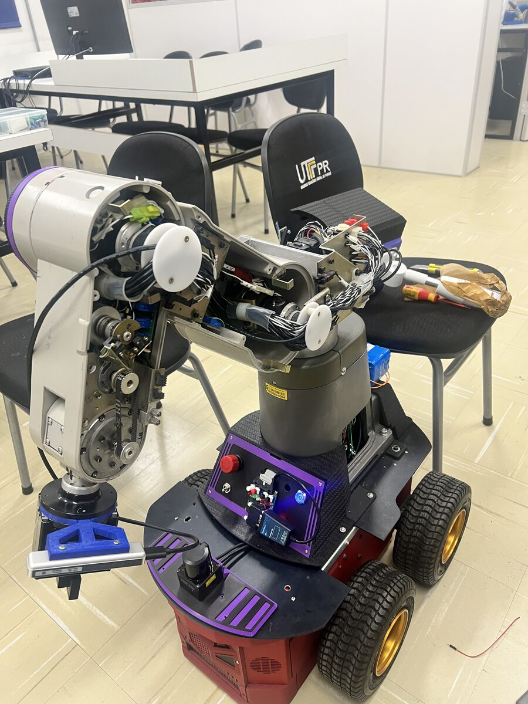
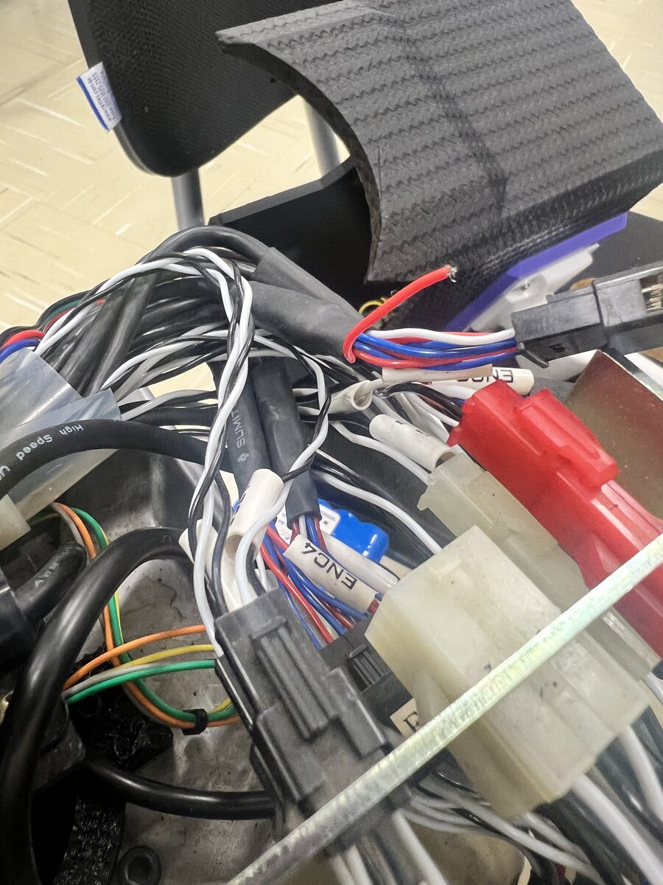
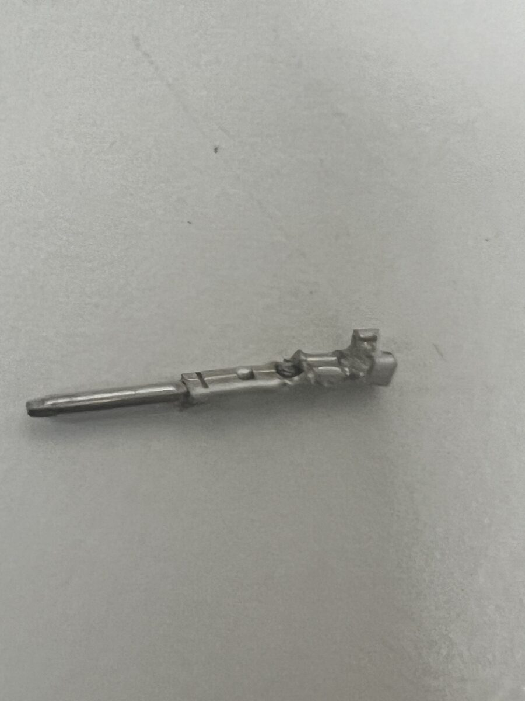
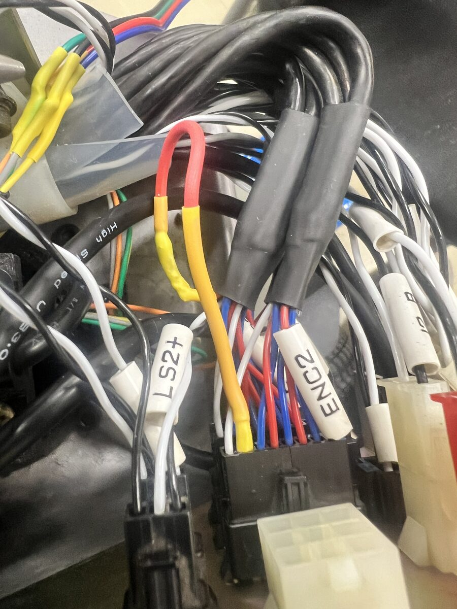

# RELATORIO61 — o cabo partido do sensor de baixo do J3 — 17 a 25 Nov 2026

Marco: "crie um relatório desse evento do cabo com as fotos". Robô real, bancada do laboratório, braço com o firmware
de velocidade `Joints34_vel` (placa 2). Fotos do Marco, de 25 Nov.

## Resumo

O fim de curso de baixo do cotovelo (J3, pino 36 da placa 2) lia sempre acionado e bloqueava toda descida da junta. O
sensor estava bom. O fio de sinal tinha partido na crimpagem do pino do conector, que fica na traseira do robô. A shield
dos Arduinos tem resistores nas entradas dos fins de curso (informação do Marco, 26 Nov). Com o fio partido, a entrada
lia alto, o que o firmware trata como "acionado". Logo, o resistor puxa para 5 V (pull-up), e o sensor, quando livre,
leva a linha ao terra. O Marco abriu o braço, refez a ligação do pino, e no mesmo dia o J3 cortou e bloqueou
corretamente nos dois sensores.

### Como a entrada funciona (deduzido dos sintomas; a confirmar com multímetro na shield)

| situação | saída do sensor | linha na placa | firmware |
|---|---|---|---|
| sem metal (LED aceso) | conduz para o terra | 0 V | livre |
| com metal (LED apagado) | aberta | 5 V, pelo pull-up | acionado |
| fio partido | — | 5 V, pelo pull-up | acionado |
| sensor sem alimentação (bateria fraca) | aberta | 5 V, pelo pull-up | acionado (todas as juntas juntas, como em 19 Nov) |

O projeto é à prova de falha: fio partido ou sensor sem energia bloqueiam a junta em vez de deixá-la sem proteção.

## Linha do tempo

| data | o que vimos | o que concluímos |
|---|---|---|
| 17 Nov | J3 publica −1 o tempo todo (744 leituras), mesmo com o cotovelo levantado. Toda descida (PWM > 0) é bloqueada | chave de baixo "presa" |
| 18 Nov | firmware de diagnóstico com os pinos crus: o sensor de cima chega ao pino 34; o de baixo não mexe em nada, e o pino 36 fica sempre em 1. O LED do sensor apaga com o metal | sensor bom; suspeita de fio partido ou conector solto |
| 18 Nov | a publicação `DIR_SIGN * (A ? 1 : B ? −1 : 0)` esconde o pino B quando o A está "preso" | o código normal mascarava o sensor de cima; só o firmware de diagnóstico mostrava os dois |
| 19 Nov | com bateria boa, o motor do J3 está normal; as falhas do motor de 17 e 18 Nov eram bateria fraca. O pino 36 continua em 1 com o metal no sensor | o problema é só o sinal do sensor de baixo |
| 19 Nov | o Marco revisa os cabos visualmente: nada aparente | — |
| 19 Nov | firmware de varredura (`/scan_34`, pinos D2 a D69, só leitura) em três fases: sem metal, com metal, sem metal. **Nenhum** pino acompanha o sensor; o 36 fica em 1 | o sinal sai do sensor e não chega a pino nenhum da placa 2 |
| 25 Nov | o Marco abre o braço e acha o fio partido no conector (fotos abaixo); refaz a ligação | — |
| 25 Nov | metal no sensor de baixo → `arm_switch_34` −1 limpo por 5 s; descida até o sensor com corte real; descida bloqueada no sensor; subida sai do sensor | **reparado**; J3 conferido nos dois sensores (PR #131) |

## O reparo

O conector do sensor fica na parte traseira do robô, mas para chegar até ele foi preciso abrir o braço inteiro.

No meio do chicote, o fio vermelho do sensor de baixo do J3 estava partido rente ao conector.

O fio partiu bem na crimpagem do pino.

O que o Marco tentou, nesta ordem:

1. **Reconectar o fio no pino:** não firmou.
2. **Soldar o fio partido direto no pino:** sem resultado firme.
3. **Funcionou:** soldar um pedaço de fio novo no pino, lixar o excesso de solda até o pino voltar a entrar no conector, e
   então soldar esse fio novo no cabo partido. A emenda ficou isolada em amarelo.

## Verificação depois do reparo (25 Nov, ponte 2, firmware da main)

| teste | resultado |
|---|---|
| J3 parado no sensor de cima | +1 (antes do reparo lia −1: o pino 36 em alto escondia o de cima) |
| metal no sensor de baixo | −1 de 38,0 a 43,1 s, sem oscilação; J4 em 0 o tempo todo |
| descida pelo motor, PWM +75 por 0,5 s | 15 mm, o freio segurou |
| descida até o sensor de baixo | corte real: PWM a 0 sem o hold de 150 ms; leitura −1 |
| pulso de descida no sensor | PWM 0 o tempo todo, braço parado |
| pulso de subida no sensor, PWM −206 por 0,5 s | subiu 12 mm, leitura −1 → 0 |

Na primeira tentativa de descida, nada se mexeu: o cabo dos motores tinha ficado desligado depois do reparo. O PWM chegava
à placa e não chegava ao motor.

## Lições

- **Um fio partido parece um sensor acionado.** Com o pull-up da shield, um fio partido lê como fim de curso preso. É de
  propósito: a falha bloqueia a junta. Quando uma chave parecer presa, desconfiar primeiro do cabo. Quando **todas**
  parecerem presas ao mesmo tempo, desconfiar da alimentação dos sensores, ou seja, da bateria.
- **O LED do sensor não é o sinal da placa.** Nos sensores do braço, o LED fica aceso sem metal e apaga com metal. Ele
  mostra que o sensor funciona, não que o sinal chega.
- **A publicação esconde um pino.** `A ? 1 : B ? −1 : 0` mostra só o sensor A quando os dois estão altos. Para
  diagnosticar chaves, usar o firmware de diagnóstico ou o de varredura, que mostram os pinos crus.
- **Uma varredura de todos os pinos separa sensor de fiação.** Se nenhum pino segue o sensor, o defeito está no caminho,
  e a busca vai para o chicote.
- **A bateria fraca confundiu o diagnóstico.** Em 17 e 18 Nov, motor fraco e fins de curso todos altos vinham da bateria,
  e pareciam o mesmo defeito do cabo. Antes de diagnosticar o braço, conferir a bateria.
- **O ponto que quebra é a crimpagem.** O fio partiu onde dobra toda vez que se mexe no chicote. Vale inspecionar as
  outras crimpagens desse conector na próxima vez que o braço estiver aberto.

## Arquivos

| arquivo | o que é |
|---|---|
| `../img/bancada/2026-11-25_robo_aberto_IMG_0906.jpg` | braço aberto para alcançar o conector |
| `../img/bancada/2026-11-25_j3_cabo_partido_IMG_0899.jpg` | fio vermelho partido junto ao conector |
| `../img/bancada/2026-11-25_j3_pino_IMG_0900.jpg` | pino retirado, com a crimpagem partida |
| `../img/bancada/2026-11-25_j3_cabo_soldado_IMG_0903.jpg` | fio novo soldado e emendado, isolado em amarelo |

As fotos foram convertidas de HEIC para JPEG (900×1200) e estão sem metadados. Os originais ficaram nos Downloads do
Marco. Os registros de leitura estão na NUC, em `~/bancada_logs/` (`ls34_leitura.csv` de 17 Nov, `j3_sensor_1125_1800.csv`
e `j3_corte_baixo_*.csv` de 25 Nov). Os firmwares de diagnóstico e de varredura ficaram fora do repositório.
